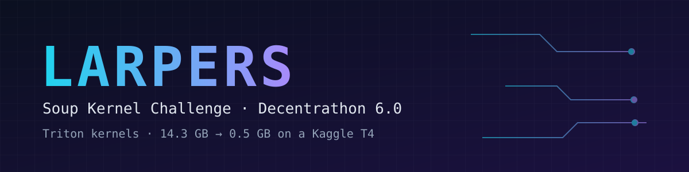

<p align="center">
  
</p>

# Soup Kernel Challenge — команда LARPERS

Хакатон **Decentrathon 6.0**, задача заказчика **Soup**. Наш пакет `solution/` заставляет
фиксированный запуск `soup train` (Qwen2.5-1.5B-Instruct, NF4, LoRA r=16 на q/v, batch 4,
64 шага, Kaggle T4) уместиться примерно в **0,5 ГБ видеопамяти вместо 14,3 ГБ**. Адаптер при этом
получается того же качества, а сам запуск идёт быстрее базы. Арифметику считают восемь наших
Triton-кернелов. Вокруг них мы построили систему экономии памяти: веса слоёв стримятся из памяти
CPU, слои пересчитываются в backward, паддинг не считается, а голова на 152 тыс. токенов идёт
кусками по словарю.

## Команда

| Участник | Роль |
|---|---|
| **Серік Азамат** | разработчик |
| **Пичугин Павел** | разработчик |

## Ссылки

| | |
|---|---|
| Репозиторий команды, финальный коммит | https://github.com/BAITC-Hacks/hack-1b4f2831-larpers/commit/fb741edc4b98fb02990df0f059ac82da87bc1790 |
| Публичный Kaggle-ноутбук (сохранённая версия, `COMMIT` в нём = коммит выше) | **TODO**: вставить ссылку вида `https://www.kaggle.com/code/<автор>/<ноутбук>?scriptVersionId=<версия>` |
| Демо-видео (до 3 минут) | **TODO** |
| Презентация | **TODO** |
| Задание и исходный стартовый набор | https://github.com/MakazhanAlpamys/soup-kernel-challenge |

Заполненная форма сдачи лежит в [`SUBMISSION.md`](SUBMISSION.md).

## Результаты

Измерено `harness/run_task.py` на Kaggle T4. Базовый Soup и наше решение запускались в одной
сессии. Таблица взята из нашего последнего полного запуска именно этого `solution/`.
**TODO: перед сдачей заменить её цифрами сохранённой версии Kaggle-ноутбука (`--repeats 2`).**

| | Базовый Soup 0.77.0 | Наше решение | Соотношение |
|---|---|---|---|
| Время всей команды `soup train` | 86,43 с | 67,94 с | speedup **1,27x** |
| Пик памяти GPU (nvidia-smi) | 14 345 MiB | 555 MiB | memory base/solution **25,8x** |
| Eval loss, открытые строки 40000–40255 | 2,04965 | 2,04960 | −0,002 % к базе |

- Все 10 проверок `harness/check_rules.py` пройдены.
- Наши кернелы занимают **18,3 %** времени обучения (проверка 4, шаги с 3-го, CUDA-события).
  Требование: не менее 5 %.
- Кривая потерь следует за базой в среднем в пределах 0,05 %, первый шаг отличается на 0,02 %.
  Допуск по ТЗ: 3 % в среднем и 1 % на первом шаге.
- Абсолютное время на Kaggle гуляет до ~20 % между сессиями (база у нас 75–101 с), поэтому сравнивать
  нужно отношение к базе в той же сессии.

### Как мы к этому пришли

Каждая строка — отдельный замер на той же задаче. Отношение времени «решение/база» берётся внутри
одного запуска. Эти замеры сделаны на промежуточных версиях, поэтому итоговые цифры выше немного
отличаются.

| Шаг | Пик, MiB | Время решение/база |
|---|---|---|
| Базовый Soup | 14 345 | 1,00 |
| Слитая голова + CE, RMSNorm с выходом fp16 | 6 463 | 0,82 |
| + без паддинга вне attention, fp16-эмбеддинг, RoPE, свой SwiGLU | 4 641 | 0,72 |
| + проекции attention без паддинга, LoRA-кернел | 4 289 | 0,71 |
| + пересчёт слоёв, меньшие куски головы | 1 721 – 2 135 | 0,83 |
| + 4-битные веса слоёв стримятся из pinned-памяти CPU | 1 371 | 0,84 |
| + без прогрева аллокатора, эмбеддинг и голова на CPU со стримингом | 593 | 0,88 |
| + покадровый (per-row) causal attention без паддинга | 519 | 0,93 |

## Как запустить

### На Kaggle (так запускает жюри)

1. Create → New Notebook → File → Import Notebook → `templates/kaggle_notebook.ipynb`.
2. Settings: Accelerator **GPU T4 x2** (используется одна карта), Internet **on**. Если репозиторий
   приватный, добавьте Kaggle secret `GITHUB_TOKEN` (токен только на чтение).
3. В первой ячейке укажите `REPO_URL` (этот репозиторий) и `COMMIT` (финальный коммит).
4. **Run All**, около 12 минут. Ноутбук ставит зафиксированные версии пакетов, готовит данные,
   гоняет тесты наших кернелов (`pytest solution`), обучает базовый Soup и наше решение, оценивает
   оба адаптера и печатает проверки.

### Локально на Linux с T4

Цифры засчитываются только с Kaggle.

```bash
pip install "soup-cli[train]==0.77.0" "transformers==5.16.1" "peft==0.20.0" "trl==0.29.1" \
    "bitsandbytes==0.50.2" "accelerate==1.14.0" pytest
python task/prepare_data.py
python -m pytest solution -q          # наши кернелы против обычного PyTorch
python harness/run_task.py            # --repeats 2 даёт порядок запусков жюри
python harness/check_rules.py
```

Если в процессе ноутбука вы запускали любой CUDA-код, перезапустите ядро перед замером: харнесс
суммирует память всех процессов на GPU. Результаты по запускам лежат в `runs/result.json`
и `runs/checks.json`.

## Что мы сделали и почему

Базовый Soup на этой задаче пикует на 14,3 ГБ по трём причинам:
- логиты по 151 936 токенам хранятся в fp16 и fp32, плюс их копии для энтропии и точности в TRL и
  для журнала rewind в Soup;
- `prepare_model_for_kbit_training` держит residual stream, нормы и связанный эмбеддинг/голову
  в fp32, поэтому все активации всех слоёв лежат в fp32;
- активации всех 28 слоёв живут до самого backward.

Время уходит на поэлементные операции и приведения типов (44 %), а также на матмулы по
батчам с паддингом.

### Наши Triton-кернелы (`@triton.jit`, все в `solution/`)

| Кернел | Файл | Что делает |
|---|---|---|
| `soup_nf4_dequant_kernel` | `nf4.py` | Распаковка NF4 с двойным квантованием масштабов за один проход вместо трёх кернелов bitsandbytes. Работает в forward и backward каждой 4-битной проекции. |
| `soup_ce_stream_kernel` | `fused_ce.py` | Один кусок словаря в голове модели: online-softmax на каждую строку (максимум, сумма экспонент, сумма exp·x для энтропии, argmax, логит цели). Для строк с метками превращает логиты в exp(x − max) для градиента. |
| `soup_ce_rows_kernel` | `fused_ce.py` | Та же голова для весов, лежащих на GPU: LSE, энтропия, argmax и softmax − onehot прямо на месте. Включается при `EMBEDDING_ON_CPU = False`, в итоговой конфигурации не запускается. |
| `soup_rmsnorm_fwd_kernel` / `_bwd_kernel` | `rmsnorm.py` | RMSNorm. Читает fp32 residual, пишет fp16 (в таком типе его всё равно ждёт следующий матмул). Сохраняет нормализованную строку в fp16 и один rstd на строку. Backward пересчитывает из них (вес заморожен: считается только градиент по входу). |
| `soup_mlp_fwd_kernel` / `_bwd_kernel` | `mlp.py` | SwiGLU `silu(gate)·up`. Backward пишет d_gate/d_up поверх сохранённых gate/up, не выделяя новые буферы. Это наш собственный дизайн, а не пример: схожесть с примером 0,58 по `check_rules.py`. |
| `soup_rope_kernel` | `rope.py` | Rotary-эмбеддинг q и k одним запуском на тензор, математика в fp32, выход fp16. Backward — обратный поворот тем же кернелом, ничего не сохраняется. Заменяет шесть поэлементных операций. |
| `soup_lora_dropout_kernel` | `lora.py` | Dropout для LoRA на счётчиковом генераторе Philox (`tl.rand(seed, offset)`). Backward восстанавливает ту же маску из seed, а не хранит маску и входной тензор после dropout. |

### Слитая голова и потеря (`fused_ce.py`)
- Тензор [batch, seq, 151 936] нигде не создаётся. В итоговой конфигурации вес головы лежит в
  pinned-памяти CPU и стримится кусками по 4096 строк словаря. Пока считается один кусок, следующий
  копируется на побочном стриме в постоянный двойной буфер.
- **Хватает одного прохода по словарю.** Для каждой строки мы держим состояние online-softmax между
  кусками и копим `acc = Σ exp(x − m)·W_chunk`, пересчитывая его на `exp(m_old − m_new)`, когда
  максимум растёт. Тогда softmax·W = acc / Σexp, а градиент по скрытому состоянию равен
  softmax·W − W[target]. Каждый байт весов проходит по PCIe один раз за шаг.
- Логиты считаются только для нужных строк: размеченных (loss, accuracy, rewind) и участвующих в
  attention (энтропия TRL). Строки паддинга пропускаются.
- **`entropy`, `mean_token_accuracy`, `num_tokens` из TRL и построчные потери rewind из Soup**
  пишутся теми же формулами из выходов кернела. Построчные потери Soup читает через собственный
  протокол «шаг без логитов» (`_soup_chunked_step.token_loss`). Встроенный режим Soup
  `stream_loss_chunk` остаётся выключенным.

### Без паддинга (`unpad.py`)
- TRL дополняет каждый батч до самой длинной строки. При средней длине ~220 токенов и самой длинной
  ~350–512 около 40 % позиций — паддинг.
- Residual stream хранится как [реальные токены, hidden]. Нормы, residual-сложения, проекции
  q/k/v/o с LoRA и MLP считаются только на реальных токенах.
- **Attention идёт построчно и причинно (causal) по реальным токенам строки.** Это ровно то, что
  разрешала маска causal + padding для каждого реального токена. Работа равна Σ L², а не
  batch · L_max², и паддинг-тензор не строится.
  - Таблицы RoPE берутся один раз по позиции каждого реального токена.
  - K/V-головы повторяются так же, как в `repeat_kv` из transformers.
  - SDPA вызывается без маски и без `enable_gqa`, то есть через memory-efficient causal кернел
    (на T4 GQA откатился бы на math-кернел).
- Строки разных батчей не смешиваются, как того требуют правила.

### Система экономии памяти
- **Пересчёт слоёв** (`unpad.py`, `stream.py`): для backward хранится только вход каждого слоя
  декодера, а сам слой пересчитывается. Это наша собственная autograd-функция, переключатель Soup
  `gradient_checkpointing` остаётся выключенным. Seed-ы LoRA dropout выбираются до слоя и
  проигрываются заново, поэтому маски при пересчёте совпадают с forward.
- **4-битные веса стримятся с CPU** (`stream.py`).
  - Сразу после квантования веса bitsandbytes (`Params4bit._quantize`) его упакованные данные и
    масштабы уходят в память CPU, а на GPU остаются пустые заглушки. Модель целиком на GPU не
    оказывается даже во время загрузки.
  - На первом шаге слои упаковываются в одну pinned-арену.
  - Слой подтягивается одним копированием host→device в кольцо постоянных GPU-буферов, на слой
    вперёд, на побочном стриме, синхронизируемом событиями. Выделений на побочном стриме и
    `record_stream` нет: оба приёма заставляли аллокатор резервировать примерно вдвое больше
    живого.
- **Входы слоёв выгружаются**: fp32-вход каждого слоя асинхронно копируется в pinned-память.
  В backward он возвращается на слой вперёд.
- **Связанный эмбеддинг/голова на CPU** (`prepare.py`).
  - transformers создаёт этот единственный тензор сразу в памяти CPU, а не на GPU.
  - Эмбеддинг остаётся в fp16 через `prepare_model_for_kbit_training`: чекпойнт в bf16, fp16
    представляет его точно в используемом диапазоне, а голова и так считается в fp16 под autocast.
  - Тензор закреплён от `module.to(device)` (например, внутри `accelerate.prepare_model`).
  - Forward достаёт на CPU только строки реальных токенов.
- **Без прогрева аллокатора**: `caching_allocator_warmup` в transformers резервирует полный размер
  модели одним выделением до загрузки. Раз веса уходят с GPU по мере квантования, это резервирование
  (~1,07 ГБ) становилось пиком всего процесса.
- **Активации в fp16**: когда нормы пишут fp16, q/k/v/gate/up и произведение SwiGLU тоже fp16, а не
  fp32. Матмулы и так шли в fp16, поэтому их входы не меняются.

### Время
- Наши Triton-кернелы компилируются в фоновом потоке, пока Soup загружает модель (`warmup.py`,
  `JITFunction.warmup`, кернелы не запускаются). Каждый запуск начинается с пустого кэша, время
  компиляции входит в замер. Готовый кэш мы не поставляем.
- Когда веса не стримятся, `dequant.py` распаковывает каждый NF4-вес один раз на пересчёт и
  backward вместо двух (`kDequantizeBlockwise` занимал ~12 % времени GPU). При стриминге это
  выключено, так как эти ~94 МБ увеличили бы пик.

### Переключатели
Все в `solution/`, нужны для экспериментов. Значения по умолчанию — это сдаваемая конфигурация:
`stream.ENABLED`, `stream.OFFLOAD_INPUTS`, `stream.PREFETCH_DEPTH`, `unpad.RECOMPUTE_LAYERS`,
`unpad.PER_ROW_ATTENTION`, `prepare.EMBEDDING_ON_CPU`, `prepare.NO_ALLOCATOR_WARMUP`,
`fused_ce.HEAD_CHUNK`.

## Идеи и источники (весь код наш)

- Слитая / кусочная линейная кросс-энтропия: Liger-Kernel `FusedLinearCrossEntropy`
  (https://github.com/linkedin/Liger-Kernel) и Cut Cross-Entropy от Apple (Wijmans et al., 2024,
  https://arxiv.org/abs/2411.09009).
- Online softmax с пересчётом: Milakov & Gimelshein, 2018 (https://arxiv.org/abs/1805.02867),
  в том же виде, что в FlashAttention (Dao et al., https://arxiv.org/abs/2205.14135).
- Dropout по seed без хранения маски: туториал Triton «Low-Memory Dropout»
  (https://triton-lang.org/main/getting-started/tutorials/04-low-memory-dropout.html).
- Кернелы RMSNorm / LayerNorm: туториал Triton «Layer Normalization»
  (https://triton-lang.org/main/getting-started/tutorials/05-layer-norm.html).
- Attention переменной длины без паддинга: интерфейс varlen из FlashAttention, у нас реализован
  как построчные вызовы SDPA.
- Пересчёт активаций: Chen et al., 2016 (https://arxiv.org/abs/1604.06174). Выгрузка весов и
  активаций на CPU: ZeRO-Offload (Ren et al., 2021, https://arxiv.org/abs/2101.06840).
- Подключение патчей одним вызовом `apply()`: так Unsloth встраивается в циклы обучения.
- NF4 / QLoRA: Dettmers et al., 2023 (https://arxiv.org/abs/2305.14314).

## Ограничения и что не получилось

- **Сначала память, потом время.** Пересчёт слоёв (лишний forward на каждый слой) и стриминг по
  PCIe стоят времени. Без них те же кернелы проходят задачу примерно за 0,71 времени базы, но с
  пиком ~4,3 ГБ (коммит `073c6a0`). Мы выбрали конец компромисса, где память меньше.
- Первая версия стриминга весов (один pinned-тензор и одно копирование на вес) стоила ~12 с.
  Упаковка в одну арену и копирование по одному слою убрали большую часть этих потерь.
- Первый вариант покадрового attention оказался медленнее варианта с паддингом: покадровые RoPE и
  копии K/V давали слишком много мелких запусков для CPU Kaggle. Теперь RoPE и повтор K/V идут
  один раз для всех токенов.
- `nvidia-smi` опрашивает каждые 100 мс. Короткие всплески аллокатора (пара эмбеддингов fp32/fp16 на
  несколько мс) делали проверку 9 нестабильной, пока мы не убрали сами всплески.
- Маски LoRA dropout берутся из Philox, а не из генератора torch: распределение то же, выборки другие.
  Кривая потерь остаётся в пределах 0,05 % от базы в среднем.
- Параметры Qwen2.5-1.5B зашиты в двух местах: форма эмбеддинга в `prepare.py` и формы прогрева в
  `warmup.py`. Другая модель всё равно заработает, но без этих двух оптимизаций.
- Покадровый attention предполагает правый паддинг (по умолчанию в TRL); для других масок
  используется путь с паддингом.
- В `train.log` попадают диагностические строки (`[mem]`, `[time]`, `[load]`, `[warmup]`). Они только
  читают счётчики.
- Проверено только на Kaggle T4 (fp16, одна карта). На Ampere и новее Soup обучает в bf16, это другой
  путь.

## Структура репозитория

| Путь | Что |
|---|---|
| `assets/banner.svg` | баннер команды |
| `solution/__init__.py` | `apply()`: подключает всё, что ниже |
| `solution/fused_ce.py` | слитая голова + loss + метрики, голова на CPU со стримингом |
| `solution/rmsnorm.py`, `mlp.py`, `rope.py`, `lora.py` | кернелы и их autograd-функции |
| `solution/nf4.py` | распаковка NF4 одним Triton-кернелом |
| `solution/unpad.py` | декодер без паддинга, построчный attention, пересчёт |
| `solution/stream.py` | стриминг 4-битных весов и входов слоёв |
| `solution/prepare.py` | загрузка: эмбеддинг на CPU, без прогрева аллокатора, fp16-эмбеддинг |
| `solution/dequant.py`, `warmup.py`, `timeline.py` | однократная распаковка, фоновая компиляция, метки времени |
| `solution/test_kernels.py` | наши кернелы против обычного PyTorch (`pytest solution`) |
| `harness/`, `task/`, `tests/`, `templates/` | стартовый набор, без изменений |

Лицензия: Apache-2.0 (см. `LICENSE`, `NOTICE`).
