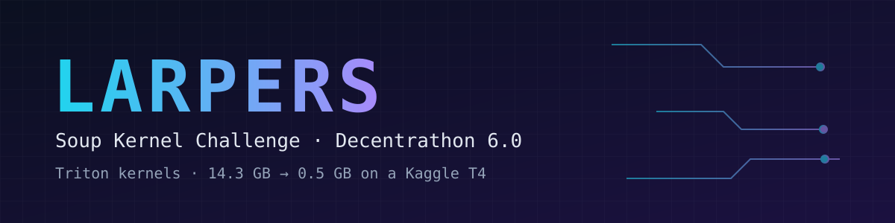

  

# Submission: LARPERS

Soup Kernel Challenge, Decentrathon 6.0. Подробное описание решения, запуск и ограничения — в
[`README.md`](README.md).

## Ссылки
- Репозиторий, финальный коммит: https://github.com/BAITC-Hacks/hack-1b4f2831-larpers/commit/28c95e3b0e3482f2388c70e9b32d3916ddb59b14
- Публичный Kaggle-ноутбук, сохранённая версия (`COMMIT` в нём = sha выше; та же ссылка есть
  в README):
  https://www.kaggle.com/code/heyyazamat/larpers-soup-kernel-combo
- Демо-видео (до 3 минут): TODO
- Презентация (PDF): https://drive.google.com/drive/folders/1XKP456izSagmXDQB-UmTQA8-u5DS5u-u?usp=sharing
  (копия в репозитории: https://github.com/BAITC-Hacks/hack-1b4f2831-larpers/blob/main/assets/LARPERS_presentation.pdf)

## Команда (до 4 человек)
| Имя | Роль | GitHub | Kaggle | Контакт (капитан) |
|---|---|---|---|---|
| Серік Азамат | разработчик | [heyyAzamat](https://github.com/heyyAzamat) | [heyyazamat](https://www.kaggle.com/heyyazamat) | |
| Пичугин Павел | разработчик | [Pavlentiyys](https://github.com/Pavlentiyys) | [mirceya](https://www.kaggle.com/mirceya) | Telegram `@Mirceya`, paulentiyss@gmail.com |

## Что сделано (коротко)
Фиксированный запуск `soup train` (Qwen2.5-1.5B-Instruct, NF4, LoRA r=16 на q/v, 64 шага, Kaggle T4)
занимает ~0,6 ГБ видеопамяти вместо 14,3 ГБ и идёт в 1,56 раза быстрее базы при том же качестве
адаптера.
- **9 собственных Triton-кернелов** считают распаковку NF4, RMSNorm, SwiGLU, RoPE, LoRA-dropout и
  слитую голову с кросс-энтропией.
- **Система экономии памяти** вокруг них: 4-битные веса слоёв стримятся из pinned-памяти CPU,
  слои не пересчитываются: активации для backward уходят в pinned-память CPU и возвращаются на слой вперёд, паддинг не считается (attention построчный), эмбеддинг/голова
  на 152 тыс. токенов живёт на CPU и идёт кусками по словарю.
- **Время:** MLP не пересчитывается в backward (его gate/up хранятся в памяти CPU), кернелы и
  их лаунчеры собираются в фоновом потоке во время загрузки, запуск Soup без лишних хэшей и
  конвертаций на CPU.
- Всё подключается одной функцией `solution.apply()`. Soup, данные, настройки LoRA и оптимизатор
  не менялись.

## Наши кернелы
| Кернел (имя `@triton.jit`) | Файл | Что заменяет | Доля времени обучения (проверка 4, по кернелам — прогон `fb741ed`) |
|---|---|---|---|
| `soup_nf4_dequant_kernel` | `solution/nf4.py` | распаковку NF4 в bitsandbytes с двойным квантованием масштабов (absmax dequant + прибавка offset + таблица NF4, три кернела) в forward и backward каждой 4-битной проекции | 8,9 % |
| `soup_lora_dropout_kernel` | `solution/lora.py` | `nn.Dropout` в LoRA из peft и его сохранённую bool-маску: маска восстанавливается из seed Philox в backward | 1,9 % |
| `soup_mlp_fwd_kernel` | `solution/mlp.py` | `silu(gate) * up` (три операции PyTorch) | 1,1 % |
| `soup_mlp_bwd_kernel` | `solution/mlp.py` | backward SwiGLU, пишется поверх сохранённых gate/up | 2,0 % |
| `soup_rmsnorm_fwd_kernel` | `solution/rmsnorm.py` | forward Qwen2RMSNorm (вход fp32, выход fp16) | 0,9 % |
| `soup_rope_kernel`, `soup_rope_qk_kernel` | `solution/rope.py` | `apply_rotary_pos_emb` (шесть поэлементных операций), прямой и обратный поворот; q и k одним запуском | 1,3 % |
| `soup_ce_stream_kernel` | `solution/fused_ce.py` | логиты lm_head + кросс-энтропия + энтропия/argmax, онлайн по кускам словаря, приходящим со стриминга | 1,0 % |
| `soup_rmsnorm_bwd_kernel` | `solution/rmsnorm.py` | backward RMSNorm по сохранённой fp16-строке | 0,7 % |
| **все вместе** | | | **17,3 %** в финальном прогоне `28c95e3` (требование: ≥ 5 %) |

`soup_ce_rows_kernel` (`solution/fused_ce.py`) — слитая голова для эмбеддинга, лежащего на GPU. В
замеряемой конфигурации он не запускается (эмбеддинг хранится в памяти CPU).

Идеи, взятые из чужих кернелов (код мы писали сами): кусочная / слитая линейная кросс-энтропия
(Liger-Kernel FusedLinearCrossEntropy, https://github.com/linkedin/Liger-Kernel; Cut Cross-Entropy,
https://arxiv.org/abs/2411.09009), online softmax (Milakov & Gimelshein,
https://arxiv.org/abs/1805.02867), тип данных NF4 (QLoRA, https://arxiv.org/abs/2305.14314;
таблица значений из bitsandbytes). Полный список источников — в README.

## Результаты на Kaggle T4 (из `runs/result.json` и `runs/checks.json` ноутбука выше)
Коммит `28c95e3` (версия 1 ноутбука), `harness/run_task.py`, база и решение в одной сессии:

| | Базовый Soup | Наше решение | Соотношение |
|---|---|---|---|
| Время `soup train`, с | 86,53 | 55,31 | speedup 1,56x |
| Пик памяти GPU, MiB | 14 345 | 639 | base/ours 22,4x |
| Eval loss (открытые строки) | 2,04965 | 2,04961 | −0,002 % к базе |

Версия 2 того же ноутбука (тот же коммит, повторный запуск на другой машине Kaggle T4): база 93,27 с → 62,44 с, speedup 1,49x; пик 641 MiB (22,4x); eval −0,004 %; 10 из 10 проверок. База на той машине тоже медленнее: 93,27 с против 86,53 с.

- [x] Все 10 проверок `harness/check_rules.py` пройдены
- [x] README.md переписан под наше решение: что сделано, как запустить, результаты, ограничения

## Проверка по пунктам раздела 7 ТЗ
| № | Требование | Статус |
|---|---|---|
| 1 | Запускается в чистом Kaggle-ноутбуке на T4 без правок | да, `templates/kaggle_notebook.ipynb`, «выполнить всё» |
| 2 | Свои Triton-кернелы ≥ 5 % времени обучения с 3-го шага | да, 17,3 % |
| 3 | Не хуже базы: loss ≤ +0,5 %, время и память ≤ +10 % | да: loss −0,002 %, время ×0,70, память ×0,038 базы |
| 4 | Нет регрессий, 79 тестов Soup и `check_rules.py` проходят | да, 10 из 10 проверок |
| 5 | README: что сделано, как запустить, результаты, ссылка на ноутбук | да |

## Презентация покрывает
Какие операции мы ускоряли и почему (поэлементные операции и приведения типов, голова на 152 тыс.
токенов, распаковка NF4, паддинг, активации всех слоёв), как устроены кернелы, результаты против базы
(скорость, память, качество), ограничения и следующие шаги.

## Ограничения
- Система памяти (4-битные веса из памяти CPU, пересчёт слоёв, входы слоёв и связанный эмбеддинг
  в памяти CPU, голова на 152 тыс. строк кусками по словарю) обменивает скорость на память.
  Запас gate/up на CPU вернул большую часть времени пересчёта, но attention-часть слоя всё ещё
  пересчитывается.
- Шина PCIe загружена плотно; при шине медленнее 8 ГБ/с запас gate/up выключается сам.
- Абсолютная скорость на Kaggle гуляет до ~20 % между сессиями (база у нас 86–101 с), поэтому
  сравнивать нужно отношение к базе внутри одной сессии.
- Покадровый attention предполагает правый паддинг (по умолчанию в TRL); для других масок
  используется путь с паддингом.
- Только путь T4 / fp16, одна видеокарта.
- Следующие шаги: хранить и тензоры attention, чтобы не пересчитывать слой совсем (свой backward
  слоя целиком); сократить ~8 с импортов в `apply()`.
